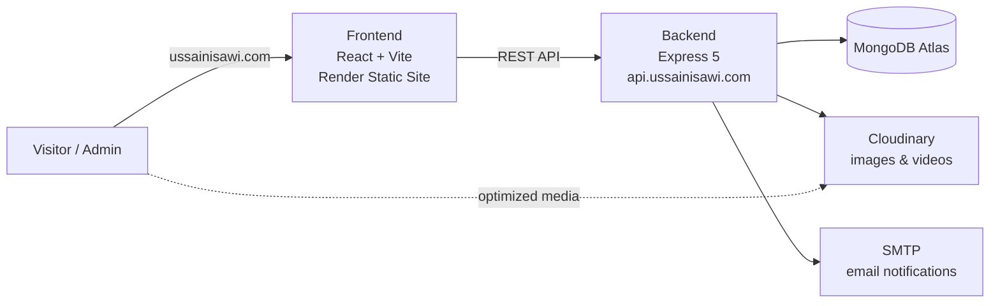

<div align="center">

# USSAIN — Book Designer Portfolio

A full-stack portfolio website for a book designer, with a custom admin dashboard to manage every book, cover, video and text on the site.

**[ussainisawi.com](https://ussainisawi.com)**


</div>

<!-- Add a screenshot of the home page: save it as docs/home.png and uncomment the line below -->
<!--  -->

---

## Overview

The site is linked from the designer's social media bios, so it is built mobile-first and opens fast inside the Instagram in-app browser. It showcases book covers and interior spreads with motion-heavy, editorial-style sections. Everything visitors see is editable from a private dashboard at `/admin`: no code changes are needed to publish a new book.

## Features

### Public site
- **3D spinning book** built with CSS 3D transforms only (no WebGL), draggable with momentum.
- **Book pages** with the cover, project details and full-size double-page spreads.
- **Scroll-driven sections**: stacked panels with looping videos, an expanding video reel, word-by-word text reveal and animated counters.
- **Smooth scrolling** (Lenis) and page-slide transitions, with a reduced-motion fallback.
- **Contact form** saved to the database, with an email notification to the designer.
- **Optimized media**: Cloudinary delivers images in WebP/AVIF at the exact width needed, and videos are compressed and lighter on phones.
- **Social previews** (Open Graph) for WhatsApp, Instagram, LinkedIn and X.

### Admin dashboard (`/admin`)
- **Books**: create, edit, publish/draft and drag-to-reorder, with the cover, spreads, book format and project details.
- **Content lists**: exclusive covers, testimonials (shown only with the client's consent), FAQ, services, numbers and experience.
- **3D book**: choose up to 12 covers for the spinning book on the home page.
- **Settings**: contact info, clock and time zone, availability status, social links and the three home-page videos.
- **Messages**: an inbox for the contact form.
- **Account**: change the password and download a full JSON backup.
- **Uploads** go straight to Cloudinary. Unsaved uploads are cleaned up automatically, and removed images are deleted from storage on save.

## Architecture



The frontend and backend live in one repository and deploy as two separate services. The API runs on a subdomain of the site, so the admin session cookie stays first-party, which matters for Safari.

## Tech stack

| Layer | Tools |
|---|---|
| Frontend | React 19, TypeScript, Vite, Tailwind CSS v4, Motion, React Router, Lenis |
| Backend | Node.js, Express 5, TypeScript, Mongoose, Zod |
| Auth | JWT in an httpOnly cookie, bcrypt, rate limiting |
| Media | Cloudinary (upload + on-the-fly transformations) |
| Email | Nodemailer over SMTP |
| Hosting | Render (Static Site + Web Service), MongoDB Atlas |

## Project structure

```
book-portfolio/
├── FRONTEND/
│   └── src/
│       ├── pages/        # Home, Works, Book, About/Services, Contact, Process, 404
│       ├── components/   # Site sections (BookFan, StackReveal, CoverMarquee…)
│       ├── admin/        # Dashboard (lazy-loaded, separate from the public bundle)
│       ├── data/         # siteData.ts: fetches & shapes all content from the API
│       └── lib/          # API client, Cloudinary helpers, smooth scroll
└── BACKEND/
    └── src/
        ├── routes/ controllers/ models/   # REST API
        ├── content/      # Generic registry for list-type content
        ├── middleware/   # Auth, uploads, error handling
        ├── services/     # Cloudinary, email
        └── scripts/      # create-admin, seed, restore
```

## Getting started

### Prerequisites
- Node.js 20 or newer
- A MongoDB database (local, or a free MongoDB Atlas cluster)
- A Cloudinary account (free tier works)

### 1. Backend

```bash
cd BACKEND
npm install
cp .env.example .env      # then fill in your own values
npm run create-admin -- you@example.com   # asks for a password (hidden)
npm run dev               # http://localhost:4000
```

Optional: `npm run seed` adds placeholder content for local development, and `npm run seed -- --clear` removes it.

### 2. Frontend

```bash
cd FRONTEND
npm install
npm run dev               # http://localhost:5173 (admin at /admin)
```

During development the frontend talks to `http://localhost:4000` by default.

## Environment variables

**Backend** (`BACKEND/.env`, see `.env.example`):

| Variable | Description |
|---|---|
| `MONGODB_URI` | MongoDB connection string (include the database name) |
| `CLIENT_URL` | Allowed frontend origins, comma-separated (CORS) |
| `NODE_ENV` | `development` or `production` |
| `JWT_SECRET` | Long random string (32+ characters) used to sign admin sessions |
| `SESSION_DAYS` | Admin session length in days (default `7`) |
| `CLOUDINARY_CLOUD_NAME` / `_API_KEY` / `_API_SECRET` | Cloudinary credentials |
| `CLOUDINARY_FOLDER` | Upload folder (default `book-portfolio`) |
| `SMTP_HOST` / `SMTP_PORT` / `SMTP_USER` / `SMTP_PASS` | Optional: email notifications for new messages |
| `NOTIFY_EMAIL` | Optional: who receives those notifications |

The server validates every variable at startup and exits with a clear message if one is missing or invalid.

**Frontend** (`FRONTEND/.env`):

| Variable | Description |
|---|---|
| `VITE_API_URL` | Backend URL. It is read at build time, so changing it requires a rebuild. |

> Never commit `.env` files. Real secrets belong only in `.env` locally and in the hosting provider's environment settings.

## Scripts

| Where | Command | Description |
|---|---|---|
| BACKEND | `npm run dev` | Start the API with auto-reload |
| BACKEND | `npm run build` / `npm start` | Compile TypeScript and run in production |
| BACKEND | `npm run create-admin -- <email>` | Create the admin, or reset its password (logs out all devices) |
| BACKEND | `npm run restore -- <file.json> --yes` | Restore a backup downloaded from the dashboard |
| FRONTEND | `npm run dev` | Start the Vite dev server |
| FRONTEND | `npm run build` | Type-check and build to `dist/` |
| FRONTEND | `npm run lint` | Run ESLint |

## Deployment

Both apps are deployed on [Render](https://render.com):

| Service | Type | Root | Build command | Output / start |
|---|---|---|---|---|
| API | Web Service | `BACKEND` | `npm ci --include=dev && npm run build` | `npm start`, health check `/api/health` |
| Site | Static Site | `FRONTEND` | `npm ci --include=dev && npm run build` | publish `dist`, rewrite `/*` → `/index.html` |

`--include=dev` is needed because `NODE_ENV=production` would otherwise skip TypeScript during the build. Render's outbound IPs are allow-listed in MongoDB Atlas. Note that SMTP needs a paid Render instance, because free instances block outgoing mail ports.

## Security

- Admin password hashed with bcrypt, and the session stored in an httpOnly, secure, SameSite cookie.
- Changing the password invalidates every other active session.
- All admin routes are protected server-side. The `/admin` page itself holds no data.
- Rate limits on login and on the contact form, plus a honeypot field against bots.
- Request bodies validated with Zod. Uploads are restricted by file type and size and must live in the site's own Cloudinary folder.
- Helmet security headers, and CORS restricted to the site's domains.

## Credits

- **Design & content:** [USSAIN](https://ussainisawi.com), book designer
- **Development:** [Mohamed El Aissaoui](https://github.com/vannbo-93) (VANNBO)

All book designs, images and texts shown on the site belong to their owner and are not covered by any license in this repository.
